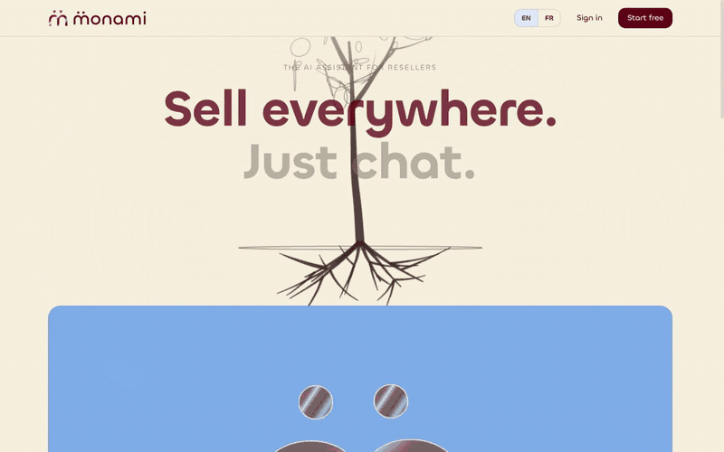

<p align="center">
  
</p>

<p align="center">
  
</p>

<p align="center"><b>Ton copain IA pour la seconde main.</b><br>monami watches your Vinted, eBay, Leboncoin and Etsy shops on its own remote desktop, tells you what buyers really pay, answers messages, publishes listings — and asks you only when it matters.</p>

<p align="center">
  <a href="https://try-ami.com">try-ami.com</a> ·
  <a href="https://app.try-ami.com">Open the app</a> ·
  <a href="#how-it-works">How it works</a> ·
  <a href="#walkthroughs">Walkthroughs</a> ·
  <a href="#run-it-yourself">Run it yourself</a>
</p>

<p align="center">
  
</p>

<p align="center">
  
</p>

---

## Why

Selling on several marketplaces means dozens of buyer messages a day ("still available?", "would you take 40 €?"), repetitive listing forms, and the constant fear of getting your account flagged if you automate with cookies and scripts.

monami keeps a **real browser on a real desktop** (a remote GPU box) logged in to your shops, like you would. It continuously captures and reads (OCR) that screen, so the agent knows what's on each Messages tab for **zero LLM tokens**. Only when something new appears does **Hermes** (the agent) wake up, read the conversation and act — with the mouse and keyboard, in your tab, at human pace.

## What it does

| Use case | How |
|---|---|
| **Inbox autopilot, 24/7** | One default-enabled workflow per connected marketplace. A Gmail notification ("new message on Vinted") or the 2-minute timer triggers a the screen reader read of the Messages tab kept open on the desktop. New buyer message → Hermes replies in the buyer's language. |
| **Negotiation with guardrails** | Discounts up to the limit you set in **Settings** (10 % by default) are accepted and sent. Above it, an **Approval needed** card appears in your chat with the proposed answer: *Approve & send* / *Decline*. Payments, deletions and price changes are never automatic. |
| **Publish from a chat message** | "Sell this T-shirt on Vinted at 1 500 €" + 2 photos in the chat → the photos are copied to the desktop, Hermes fills the Vinted form, attaches them, asks you before *Publish*, and sends back the **screen recording** of what it did. |
| **Teach by doing** | Click *Teach by doing*, do the task once in the remote browser, click *Stop*. Hermes turns the screen capture of your demonstration into a reusable workflow card (trigger, steps, guardrails). |
| **Shops & listings, for real** | Connect a marketplace by logging in on the remote desktop; accounts, listings and photos are read from the screen into **Shops** (with a *Refresh listings* button). |
| **Notifications** | Every reply the agent sends to a buyer shows up as a *Reply sent* card in the chat, a toast on any page and an unread badge on *Chat*. |

## Walkthroughs

- **Teach a workflow by doing it.** Click *Teach by doing*, do the task once in the remote browser, click *Stop*: monami turns the screen capture of your demonstration into a reusable workflow card (trigger, steps, guardrails).
- **Publish a listing from the chat.** "Sell this T-shirt on Vinted at 15 €" + 2 photos → the photos land on the desktop, the agent fills the form, asks you before *Publish* and posts the screen recording in the chat.
- **Dashboard tour.** Shops synced from the screen with *your price vs market* on every listing, inbox-autopilot workflows, the remote desktop, plans and usage, API key + MCP in Settings.

## How it works

```
 Seller (web, mobile)                        Remote desktop (GPU box)      
 ┌──────────────────────┐                    ┌─────────────────────────────────────────┐
 │ Next.js app (Vercel) │  HTTPS /backend/*  │  Xfce + Chrome: one Messages tab per    │
 │ chat · shops · flows │───────────────┐    │  marketplace, always open & logged in   │
 └──────────────────────┘               │    │                                         │
                                        ▼    │  Screen OCR  ── reads the screen ──►   │
 ┌──────────────────────┐   signed calls     │  inbox monitor (0 tokens until a new    │
 │ FastAPI control plane│───────────────────►│  buyer message is seen)                 │
 │ (Hetzner) auth, DB,  │◄───────────────────│         │ wakes                         │
 │ approvals, recordings│   cards, syncs     │         ▼                               │
 └──────────────────────┘                    │  Hermes agent (NemoClaw)                 │
            ▲                                │  desktop_* / browser_* tools via CDP,   │
            │ Gmail notification             │  screen recording, approval guardrails  │
     "New message on Vinted"                 └─────────────────────────────────────────┘
```

- **Screen first.** The inbox monitor compares the OCR text of each Messages tab between passes; Hermes is only called when new buyer text appears. In the chat, "what are my latest Vinted messages?" is answered from the screen reader too, and the agent says which source it used.
- **No cookie export, no private APIs.** Sessions live in the remote Chrome only; the agent clicks and types like a person. CAPTCHA / anti-bot checks are never bypassed — if a marketplace asks for a human, you get the remote desktop in a modal and do it yourself.
- **Human in the loop where it counts.** Approval cards for discounts above your limit, disputes, refunds, publishing. Everything the agent does on the desktop is recorded and the `.mp4` is posted in the chat.

## Run it yourself

Three pieces:

1. **Front** (`/`, Next.js 16): `cp .env.example .env.local && npm install && npm run dev`. The browser talks to the API through the same-origin `/backend/*` rewrite, so Vercel needs no secrets.
2. **API** (`backend/`, FastAPI + SQLite): `cp backend/.env.example backend/.env`, fill `APP_ACCESS_PASSWORD`, `APP_SESSION_SECRET`, `DESKTOP_*`, `HERMES_*`, then `uvicorn app.main:app --host 127.0.0.1 --port 3000`.
3. **Remote desktop**: a Linux box with Xfce + Chrome (remote-debugging on `127.0.0.1:9222`), a screen OCR service on `127.0.0.1:3030`, Hermes (NemoClaw) with the MonAmi MCP tools, and the small desktop gate / inbox monitor services. `DESKTOP_BASE_URL` of the API points at that gate.

## Security

This repository is public. **No secret is committed**: every key lives in the API's `.env` on the server and in root-only env files on the remote desktop. `*.env.example` files are templates with empty values. If you fork it, rotate anything you paste anywhere.

## Stack

Next.js 16 · React 19 · Tailwind · shadcn/ui · Clerk · Stripe · FastAPI · Aiven (PostgreSQL, Kafka, Valkey, ClickHouse, Runtime) · Hermes (NemoClaw) · Chrome DevTools Protocol · ffmpeg · Vercel + Hetzner + a GPU box for the desktops.
